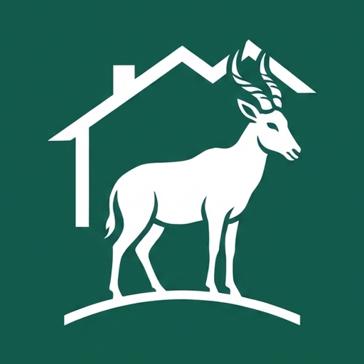

   

     
   

 ## Tora

Addis Ababa is growing upward. Every year more families move into compounds and apartment blocks, and behind every one of them is an office keeping it running: on paper ledgers, stacks of receipts and a phone that never stops ringing.

We think the people who look after where we live deserve better tools. And the people who live there deserve to know where they stand.

**Our name comes from the Tora hartebeest**, an antelope found only in this part of Africa. Hartebeest live in herds, and while the herd grazes, one stands on high ground and keeps watch, so everyone else can get on with their day.

That's what we're building: software that keeps watch over a community, quietly, so the people in it don't have to worry.
